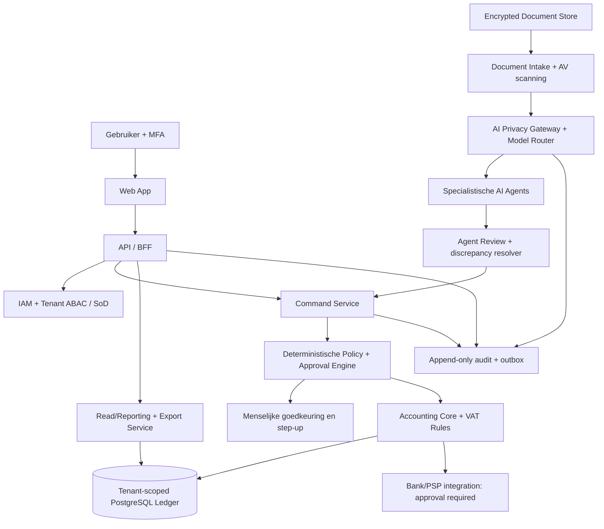

# 02 — Referentiearchitectuur

## Principes
Start als **modulaire monoliet** met duidelijke domeingrenzen; afzonderlijke AI-worker/service en policy-service met strenge interface. Voorkomt vroegtijdige microservicecomplexiteit, zonder security boundaries te vervagen. Technologievoorstel ter besluitvorming: TypeScript/Node (NestJS of Fastify), React/Next.js, PostgreSQL, objectstorage (S3-compatible in EER), Redis/queue, OpenTelemetry; Pulumi/Terraform. Valideer later de exacte stack via ADR. PostgreSQL RLS is een extra beveiligingslaag, **niet** de enige autorisatiecontrole.

## Logische componenten


## Trust boundaries
1. Browser ↔ API: zero trust, MFA, session binding, rate limits, CSRF protection.
2. Tenant ↔ tenant: `tenant_id` and `legal_entity_id` mandatory from authenticated context, never from untrusted agent input; property-based cross-tenant tests.
3. Documents/email/uploads ↔ AI: untrusted content; strip instructions and isolate data; anti-virus & MIME validation; prompt-injection tests.
4. AI ↔ commands: AI proposes structured `ActionProposal`; API independently validates authorization, approval policy and financial invariants; model cannot call unsafe tools directly.
5. Commands ↔ bank: signed instructions, idempotency, status tracking; **geen AI-initiated authorization**; separate final bank confirmation.
6. Model-provider ↔ platform: explicit allowlist, data minimization, tenant AI policy, processor agreements, regional transfer assessment, no unapproved fallback.

## Bounded contexts
Identity & Access; Tenancy; Document Intake; Master Data; AP & Procurement; AR & Billing; Banking; GL & Tax; Workflow & Approval; AI Orchestration; Risk/Fraud; Reporting & Exports; Audit & Compliance; Configuration & Integrations.

## Conceptueel datamodel
```
tenants(id, status, region, ai_policy_id)
legal_entities(id, tenant_id, country, currency)
users(id, tenant_id, external_identity_id, status)
roles / permissions / role_bindings / mandates / sod_rules
accounts(id, tenant_id, legal_entity_id, code, kind)
periods(id, tenant_id, legal_entity_id, state)
partners(id, tenant_id, kind, verification_status)
partner_bank_accounts(id, tenant_id, partner_id, encrypted_iban, status)
documents(id, tenant_id, blob_ref, hash, type, retention_class)
invoices(id, tenant_id, legal_entity_id, partner_id, doc_id, state, version)
invoice_lines(id, tenant_id, invoice_id, tax_code, ledger_account_id, money)
journal_entries(id, tenant_id, legal_entity_id, period_id, status, source_id, posted_at)
journal_lines(id, tenant_id, entry_id, account_id, debit, credit, currency)
approval_policies(id, tenant_id, version, compiled_rules, active_at)
approval_requests(id, tenant_id, object_ref, snapshot_hash, policy_version, status)
approval_decisions(id, tenant_id, request_id, user_id, step_id, action, mfa_evidence)
payment_batches / payment_instructions / bank_events
ai_tasks(id, tenant_id, purpose, provider_id, model_id, policy_version, status)
ai_data_disclosures(id, tenant_id, task_id, destination, purpose, fields_manifest_hash, region, retention_profile)
ai_agent_reviews(id, tenant_id, task_id, agent_role, result, evidence_refs)
audit_events(id, tenant_id, actor_type, actor_id, action, object_ref, immutable_payload_hash)
exports(id, tenant_id, user_id, view_id, filters_hash, columns, authorized_row_count, expires_at)
```
Migrations enforce FK/tenant consistency; unique posting and idempotency keys. Exact schemas defined and reviewed per sprint.

## Boekhoudkundige invarianten
- Debet en credit exact gelijk voor iedere posted entry (per currency, with explicitly modeled FX handling), geen write/delete van posted lines.
- `Decimal(precision, scale)` of integer minor units voor bedragen; rounding policies per currency; never JS float as source of truth.
- Gegenereerde journaalposten transactioneel en herhaalbaar; correction = reversal + repost; fiscale/audittrace behouden.
- Period closure via controlled workflow; preventing backdating and direct edits; journal/report snapshots reproducible.
- Exacte matching tussen payment execution, bank settlement en reconciliatie; statuses `proposed/approved/submitted/accepted/settled/failed/reversed` niet conflateren.

## API/commands
Voorbeeld: `POST /v1/invoices/{id}/propose-posting` -> generated proposal; `POST /v1/approval-requests` -> immutable snapshot; `POST /v1/approvals/{id}/decisions` -> checks identity/SoD/MFA; `POST /v1/journals/{id}/post` -> policy + invariants; `POST /v1/exports` -> view-specific authorized query. AI krijgt eigen beperkte proposal endpoints, geen `post`, `approve`, `execute_payment`, `manage_users`.

## Security operations
- KMS-managed encryption at rest/TLS, secrets manager, segregated prod/dev, offsite encrypted backups with tested restore, append-only tamper-evident audit exported to independent security account.
- MFA/step-up, session revocation, least privilege, service-to-service auth, signed webhook verification, dependency/SAST/DAST scans, tenant isolation testing, incident response.
- Audits: business event log vs AI disclosure ledger vs security audit log zijn afzonderlijk; audit storage heeft beperkte toegang en eigen retention.
- Geen real financial data naar logs/telemetry of product analytics; secure redaction and sampling policy.

## Exports
Uniforme `ExportViewDefinition` per UI-screen (view ID, query spec, allowed columns, field classification, export formats). Autoriseer query opnieuw op backend; escape Excel formula-like values, audit downloads, expiring URLs, optional approval for mass export; XAF naast XLSX/CSV.

## Domeinuitbreiding: moduleconfiguratie (ADR-008)
- `ProfileTemplate` (platformbeheerd, versioned) definieert een default **selectie** van ModuleIDs. `ModuleCatalog` definieert features, dependencies, compatibilities, version, UI route, API capabilities en optionele AI-data requirements.
- `TenantModuleConfig` legt tenantkeuzes, configuratieversie, actor, tijd, effectiveAt en status vast. `ModuleLifecycleService` voert validate -> preview -> approval (indien nodig) -> activate/deactivate -> audit uit. Activeringsregels mogen bestaande ACL of veiligheidscontroles niet verruimen.
- `AIScopeAuthorization` is apart en gekoppeld aan tenant, administratie, module, verwerkingsdoel, datacategorie, provider, regio, retentieprofiel, geldigheidsduur en goedkeurende actor. Product-policy: standaard geen externe AI-egress. Een functionaliteit activeren vormt geen juridische AVG-grondslag of impliciete AI-autorisatie.
- Module enforcement op frontend (navigatie), backend (API guards), jobs, exports en AI-router. UI-verborgen routes alleen zijn onvoldoende. Per-module read-only historische toegang na deactiveren conform recht/retentiebeleid.
- Alleen modules kunnen uit; vaste control-plane voor IAM, ledger, approval, privacy gateway en audit is verplicht.

## Domeinuitbreiding: meerdere entiteiten en consolidatie (ADR-009)
- `Tenant` = klantorganisatie/beveiligingsgrens; `LegalEntity` = juridische verslaggevende eenheid; `LedgerAdministration` = boekingsomgeving/bronadministratie, gekoppeld aan LegalEntity; `BusinessUnit` = optionele operationele indeling, geen zelfstandige entiteit tenzij expliciet aangemaakt.
- `DimensionType`, `DimensionMember`, `DimensionHierarchy`, `DimensionMapping` = optioneel, configureerbaar per tenant/administratie, geldigheidsdatums en versies. Geen verplichte vaste niveaus of parent-child-relatie tussen verschillende dimensietypen.
- `ConsolidationGroup` = expliciet gedefinieerde rapportagegroep met lidmaatschap (scope + periode + ownership/control parameters), mappings, groepsvaluta, consolidatiebeleid, approvers. `ConsolidationRun` bevriest bronversies, periode, rates en regels.
- `ConsolidationLedger` is fysiek/logisch afgescheiden van operationele journals; `EliminationProposal` -> deterministic reconciliation/validation -> human review -> `ConsolidationAdjustmentJournal` -> approved snapshot. Alleen daar mag eliminatie worden geboekt. `ConsolidatedReadModel` = bronadministraties + policy-mappings + geldige consolidatiejournals, met lijnherkomst en reconciliation status.
- **Geconsolideerde view heeft geen gewone create/edit/post API.** Specifieke consolidatie-adminroutes zijn een apart beveiligd werkoppervlak (niet dezelfde view), met SoD, dual approval bij kritieke verschillen, audit en versies.
- Consolidatie is niet simpel optellen: rekeningmapping, periodeverschillen, valuta-/FX-regels, eigendomspercentages, intercompany pairing, eliminaties, eventuele minderheidsbelangen en verslaggevingsstandaard moeten expliciet worden geconfigureerd en specialistisch worden getoetst vóór productie. Ontbrekende mapping/rate of unmatched intercompany => onvolledig/geblokkeerd, niet geschat door AI.
- Voor identieke juridische entiteit met Retail/Wholesale als segmenten is een segmentrapportage/roll-up van dimensies doorgaans passender dan juridische consolidatie. Ondersteun beide zonder terminologie te verwarren.

### Conceptuele extra tabellen (allemaal tenant-scoped waar van toepassing)
```
profile_templates(id, version, name, default_module_ids, published_at)
module_catalog(id, version, dependencies, capabilities, processing_classification)
tenant_modules(id, tenant_id, module_id, enabled, config_version, changed_by)
tenant_ai_authorizations(id, tenant_id, administration_id?, module_id, purpose,
    data_categories, provider_id?, region?, expires_at, approved_by, policy_version)
ledger_administrations(id, tenant_id, legal_entity_id, functional_currency, chart_id)
business_units(id, tenant_id, legal_entity_id?, administration_id?, name)
dimension_types(id, tenant_id, code, name, scope, optional)
dimension_members(id, tenant_id, type_id, code, valid_from, valid_until)
dimension_edges(id, tenant_id, hierarchy_id, parent_member_id, child_member_id, valid_from, valid_until)
journal_line_dimensions(id, tenant_id, journal_line_id, dimension_member_id)
consolidation_groups(id, tenant_id, name, reporting_currency, policy_version)
consolidation_members(id, tenant_id, group_id, administration_id, effective_from, effective_to, ownership_ratio, method)
consolidation_account_mappings(id, tenant_id, group_id, source_account_id, group_account_id, effective_from, effective_to)
intercompany_links(id, tenant_id, left_entity_id, right_entity_id, source_reference, amount, currency, reconciliation_status)
consolidation_runs(id, tenant_id, group_id, period_id, source_fingerprint, rates_version, status)
elimination_proposals(id, tenant_id, run_id, source_pairs, evidence_refs, proposed_lines, review_status)
consolidation_journals(id, tenant_id, run_id, approval_snapshot_hash, status)
consolidation_journal_lines(id, tenant_id, consolidation_journal_id, account_id, debit, credit, source_links)
```
Constraints: no cross-tenant FKs; administration membership/authorization checks; acyclic dimension hierarchies; versioned temporal mappings; unique run revisions; balanced consolidation postings per currency after explicit FX handling; no mutation of source entries; no double-counted IC eliminations; reproducible results.

### Navigatie en autorisatie
`Administratiekiezer`: tenant -> juridische entiteit -> administratie -> boekingsschermen. `Groepsweergave`: tenant -> geselecteerde consolidatiegroep/run -> *read-only* rapportages met herkomst/drilldown. `Consolidation workspace`: aparte, expliciet toegewezen adminfunctie met voorbereiden/controleren/goedkeuren eliminaties. API-guards kennen `scope_type=administration | entity | consolidation_group`; query's doen nooit unrestricted union over entiteiten.

### Workflow AI-financeteam bij consolidatie
Agent 1 identificeert potentieel intercompany paar; agent 2 vergelijkt bronfactuur/bank/open posten en duidt verschillen; agent 3 controleert consolidatievoorstel; deterministic engine valideert wederpartij, periode, rekeningschema, FX en balans; mens keurt afgeschermde eliminatieversie goed; uitsluitend de consolidation command-service post naar consolidation ledger. Geen agent heeft recht om bronadministraties te wijzigen.

## v0.3 — Annual accounts en extern auditportaal
- `AnnualAccountsService`: read-only snapshots van gesloten ledger of goedgekeurde consolidatieruns → versiebeheerbare verslaggevingsmapping → deterministische statements → AI-tekstvoorstellen → onafhankelijke validatie → menselijke review/adoptie → gecontroleerde uitvoer. Scheid wettelijke filing-status en lokale rapportgeneratie.
- `GuestEngagementService`: timeboxed purpose-bound grants; harde query-policy bij UI, API, documents, logs, RAG, AI gateway en exports. `review_notes` en `evidence_requests` schrijven uitsluitend naar aparte auditworkspace, nooit naar postings.
- `AnnualAccountsCase` scoped aan juridische entiteit en verslagjaar of expliciete consolidatiegroep, met `sourceSnapshotHash`, `mappingVersion`, `consolidationRunId?`, `reportVersion`, status en approvals. Snapshot invalidation bij materiële bronwijziging.
- SBR/XBRL deponering via afzonderlijke, nog te valideren filing adapter (geen fictieve indiening). Modules apart entitlements: `annual_accounts`, `external_auditor_portal`; guest-rights zijn geen algemene viewerrechten.
- Zie `docs/13_JAARREKENING_EN_ACCOUNTANTSPORTAAL.md` voor API en datamodel.

## v0.6 — Nieuwe architectuurcomponenten
- `i18n service`: versiebeheer vertaalcatalogus, NL/EN per gebruiker en locale-formattering.
- `migration adapters`: capability registry, staging, canonieke mapping, audit, reconciliatie; `sync outbox`: eenrichtingsverkeer platform→legacy, deduplicatie, terugkeer-gates.
- `presentation template engine`: tenant-/gebruikerconfiguratie en template-onafhankelijke action-ID plus stabiele `data-guide-id`.
- `Guided Learning plugin`: no-code tour builder en immutable versies; deterministische selector-runtime zonder LLM; AI-builder alleen pre-publicatie.
- `chat tour retrieval`: authorization-filtered published-tours, links naar runtime, geen live AI stappen.
- `module specifications`: `modules/INDEX.md` + `modules/<slug>/README.md` als canonieke plaats voor uitbreidingswensen.

## v0.7 — UI experience bounded context
Voeg `DesignSystem` (tokens/components), `AppShell`, `NavigationRegistry`, `ExperienceTemplateService`, `UserDisplayPreferences` en `GuidedLearningSelectorRegistry` als **presentatielaag** toe. Schemas scheiden `business_profile`, `module opt-in`, `experience_template`, `navigation_placement`, `locale` en `ai_processing_authorizations`. De standaard is lichte AI Finance-UI volgens de intern opgeslagen screenshotreferentie, met linkernavigatie en optionele topnavigatie per gebruiker. Template-wissel verandert **geen** finance APIs/commands, tenant-/administratiecontext, SoD of exportpolicy. Verplicht testmatrix voor templates × beide navposities × NL/EN × rechten × Guided Learning, en veilig versiebeheer voor UI-presets. Zie `docs/26_DESIGN_SYSTEM_AND_NAVIGATION.md`.

## v0.8 — Permanente ERP Integration Hub: gescheiden systeemverantwoordelijkheden
Architectuurflow: `ERP connector -> capability registry -> signed/validated event inbox -> tenant/entity router -> schema/field mapping -> deterministic accounting validator -> approval policy where required -> finance ledger OR imported ERP journal -> transactional outbox -> minimal ERP status callback`. Ledger en event inbox gescheiden; inkomende payloads nooit rechtstreeks AI-commando's. Per ERP-event één financiële autoriteit en unieke bronreferentie. Event contracts, deduplication, retry/dead-letter, admin mappings, scoped OAuth/API keys, reconciliation en controlled replay verplicht. ERP-voorraad is operationele waarheid; geconsolideerde view blijft read-only. Scheid dit van legacy migration/parallel-run; zie `docs/27_ERP_INTEGRATION_HUB.md`.

## v0.9 — SaaS Tenant & Domain Architecture
- Centrale browserapp + wildcard/managed TLS + geverifieerde hostrouter → tenant resolver → sessie/IAM → scoped API → tenant-/entiteits-/administratiegeautoriseerde ledger en opslag.
- `TenantDomain` heeft een unieke platform-subdomain mapping. De host is een lookup-hint, **geen autorisatie**; client-selected tenant wordt onafhankelijk geverifieerd. Per verzoek authz én request context, inclusief background workers, RAG, AI-data gateway, exports, gasten en caches.
- Tenant lifecycle en automatisch provisioning vanaf de basis; zie volledige detailarchitectuur `docs/28_SAAS_TENANT_SUBDOMAINS.md`.
- IT's Perfect v2 is een geplande vendor-specifieke adapter op het bestaande ERP framework, geen nieuwe bron van waarheid. Demo Data & Sandbox is optioneel/los van echte administratie. Zie `docs/29_ITS_PERFECT_REFERENCE_CONNECTOR.md`, `docs/30_PERSONALIZED_DEMO_SANDBOX.md`.
