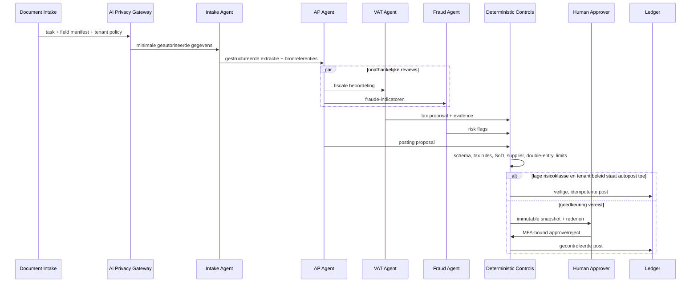

# 03 — Multi-agent Finance Team

## Kernregel
Meerdere agents mogen elkaar beoordelen, maar vormen geen echte functiescheiding als ze dezelfde tools, datasets en privileges delen. Alle definitieve financiële acties worden door **deterministische controles en mensen** goedgekeurd. Cross-agent consensus ≠ bewijs; confidence ≠ correctness.

## Agents en privileges
| Agent | Verantwoordelijkheid | Input | Output | Maximale bevoegdheid |
|---|---|---|---|---|
| 1 Intake Agent | Facturen en bonnen lezen, bronverwijzingen | Geautoriseerde documenten | Extractie met evidence | `propose` |
| 2 AP Agent | Inkoopcodering, order-/ontvangstmatch | Extracties, PO, ontvangst | Concept-boekingsregels | `propose` |
| 3 VAT/Tax Agent | Btw-codes controleren en afwijkingen markeren | Minimale factuurvelden en rule version | Tax assessment | `review` |
| 4 Fraud/Risk Agent | Duplicaten, IBAN, leveranciers- en anomalierisico | Geminimaliseerde transactiedata | Risk flags & rationale | `flag/block_proposal` |
| 5 Reconciliation Agent | Bankmatch voorstellen | Transaction identifiers, bankbookings | Match proposals | `propose` |
| 6 GL Controller Agent | Kruiscontrole op classificatie en boekingsbalans | Proposed entries, ledger context | Review findings | `review` |
| 7 Reporting Agent | Afwijkingen verklaren, rapporten schrijven | Geautoriseerde rapportagedata | Commentary with references | `read/summarize` |
| 8 Approval Coordinator | Open goedkeuringen verzamelen en uitleggen | Approval engine outcome | Routing explanation, reminders | `notify`, nooit `approve` |
| 9 Privacy & Policy Guardian | Controleren of data naar model mag, dataminimalisatie | Disclosure manifest, tenant policy | Allow/deny recommendation | `recommend`; enforcement by gateway |
| 10 AI Quality Auditor | Agent-output toetsen aan steekproeven/ground truth | Versioned evaluation fixtures | Quality report | `audit` |

**Niet iedere agent hoeft een apart LLM te zijn.** Sommige rollen (fraude-indicatoren, btw-regels, reconciliation) moeten deels of grotendeels deterministisch worden ingevuld. Kies modellen op grond van evaluaties; voor kritieke controles kan providerdiversiteit correlated failure beperken, maar introduceert aanvullende data-overdracht die expliciet toegestaan moet zijn.

## Orchestratie factuur

## Conflict- en onenigheidsprotocol
- Agent A en B verschillen op leverancier/bedrag/tax code/IBAN/risk -> auto-stop en human review; geen meerderheidsstemming.
- Onvoldoende evidence, bron ontbreekt, lage zekerheid, model timeout, policy conflict -> fail closed / manual queue.
- Agent mag nooit een andere agent opdracht geven zijn systeemrechten uit te breiden.
- Preserve provenance: page, bounding region/extraction span, source doc hash, schema version, model version, tool calls, costs, disclosure ID.
- Voor triage kan een onafhankelijke rule engine een fout detecteren zonder extra AI-provider of datadeling.

## Agent runtime contract
- `AgentTask`: tenant-scoped purpose, permitted data categories, allowable model/provider, max tokens/cost/time, required evidence, expiresAt.
- `AgentResult`: typed schema, citations to immutable source objects, uncertainties, explicit refusal/needs-review, no free-form executable instructions.
- `AgentReview`: target proposal hash, findings, severity, evidence, reviewer model/version.
- Rate/cost caps, circuit breakers, retry with idempotency, queue isolation, tenant-specific resource limits.

## Voorkomen van schijnveiligheid
- AI outputs niet blind als 'reviewed' markeren omdat een tweede agent akkoord gaat.
- Aantal agents optimaliseren op echte onafhankelijke foutdetectie, niet op marketingwaarde.
- Meet inter-agent disagreement, common-mode failure, false accept/false reject, latency, kosten en doorlooptijd.
- Agent-to-agent data is onderdeel van hetzelfde privacy- en loggingbeleid; elke provider-exposure wordt geregistreerd.

## Nieuwe rollen binnen het virtuele finance-team (geactiveerd met modules)
| Rol | Module | Verantwoordelijkheid | Verboden actie |
|---|---|---|---|
| 11 Intercompany Matching Agent | `intercompany` | Matcht overlopende vorderingen/schulden, inkomsten/kosten en wederpartijreferenties per entiteit | Boekingen corrigeren of verschillen wegboeken |
| 12 Consolidation Specialist Agent | `consolidation` | Bereidt consolidatieruns, account-mapping- en eliminatievoorstellen met bronnen voor | Definitieve eliminaties posten of groepsscope verruimen |
| 13 Independent Consolidation Review Agent | `consolidation` | Beoordeelt bronreferenties, dubbele eliminaties, FX-afwijkingen en consistentie, rapporteert afwijkingen | Onafhankelijke menselijke fiattering vervangen |
| 14 Module Configuration Advisor | `module_management` | Adviseert modules per klantprofiel en signaleert ontbrekende dependencies | Modules of AI-verwerkingsrechten autonoom aanzetten |

**Agenten alleen als benodigde module is ingeschakeld en het AI-databeleid de taak toestaat.** Een agent mag nooit via een consolidatiegroep toegang krijgen tot niet-geautoriseerde entiteitsgegevens. Agent 12 mag bij een mismatch geen sluitpost verzinnen; item naar menselijke reconciliatie. Gebruik onafhankelijke accountingregels en menselijke goedkeuring; AI-agenten die dezelfde bron of hetzelfde model delen, leveren geen gegarandeerd onafhankelijke verificatie. Vraag niet standaard méér data op om reviewers te voeden: dataminimalisatie per taak/entiteit. Zie docs 11 en 12.

## v0.3 — aanvullende agenten
- **Annual Accounts Preparation Agent**: voorgestelde rubrieken, grondslagen/toelichtingen, checklists, bronlinks; nooit autonoom cijfers bepalen, autoriseren, vaststellen of deponeren.
- **Annual Accounts Independent Review Agent**: vergelijkt rapportregels met vastgelegde snapshots/mappings en zoekt ontbrekende toelichtingen. Onafhankelijke deterministische reconciliatie blijft doorslaggevend.
- **Audit Evidence Assistant**: zoekt uitsluitend binnen expliciete gast-/engagementrechten en bereidt traceerbare bewijsstukken voor; mag geen documenten buiten die scope ophalen of exportrechten verkrijgen.
- Agentencontrole is geen wettelijk voorgeschreven accountantsonderzoek en geeft geen assurance. Jaarrekening en auditdossiers naar externe modellen uitsluitend via apart, vooraf geautoriseerd AI-databeleid.

## v0.6 — Aanvullende agents en grenzen
- **Migration Mapping Agent**: mappings voorstellen, nooit rechtstreeks importcommit; **Migration Reconciliation Reviewer**: bevindingen, onafhankelijke financiële controlemotor beslist.
- **Guided Learning Author Agent**: maakt alleen concepttour JSON uit toegestane UI metadata; **Tour Reviewer**: selectors/tests/policy en menselijke publicatie; **chat retrieval**: zoekt uitsluitend gepubliceerde toegestane tours.
- Geen AI-agent bij de uitvoering van een tour; de runtime is volledig deterministisch. Multi-agent mening is geen bewijs van financiële correctheid.

## v0.8 — ERP Integration Mapping en Reconciliation Agents (GEPLAND)
Optionele `ERP Mapping Analyst Agent` doet voorstellen voor transformaties/schema-overeenkomsten; `ERP Reconciliation Agent` beoordeelt afwijkingen, ontbrekende events en duplicates op reeds geautoriseerde gegevens. Beide zijn adviserende agents en krijgen geen directe ERP-write-, ledger-posting-, autorisatie- of connectorsecret-rechten. Onafhankelijke deterministische validatie en bevoegde menselijke goedkeuring zijn noodzakelijk. Geen AI-data-ergens-naartoe buiten per tenant geautoriseerde processing gateway; zie `docs/27_ERP_INTEGRATION_HUB.md`.
