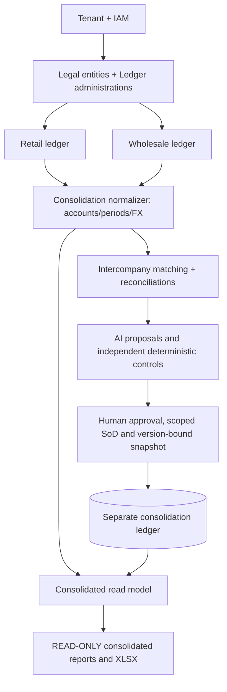

# 12 — Multi-entity, optionele dimensies en gecontroleerde consolidatie

## Begrippen: niet door elkaar halen
| Domein | Betekenis | Mag hier geboekt worden? |
|---|---|---|
| Tenant | Klant- en autorisatiegrens | Nee |
| Juridische entiteit (`LegalEntity`) | Rechtspersoon / onderneming die zelfstandig rapporteert | Via bijbehorende administratie(s) |
| Boekhoudadministratie (`LedgerAdministration`) | Boekingsomgeving met journaal, periodes, rekeningschema | **Ja**, met bevoegdheden |
| Bedrijfsonderdeel (`BusinessUnit`) | Retail, Wholesale of vergelijkbaar, hoeft geen aparte rechtspersoon te zijn | Alleen via administratie met dimensies/segmenttoewijzing |
| Kostenplaats, kostendrager, project, eigen dimensie | Optionele financiële analytische indeling | Niet zelfstandig; attributen aan boekingsregels |
| Consolidatiegroep | Vastgelegde groep administraties met eigen consolidatiebeleid | Nee in gewone groepsview |
| Consolidatie-werkruimte + consolidatieledger | Afgesloten plek voor eliminaties/adjustments | **Alleen speciale goedgekeurde consolidatiejournaalboekingen** |

## Werkvoorbeelden
**Voorbeeld A, twee juridische entiteiten:** Groep -> Retail BV (administratie R), Wholesale BV (administratie W). Wholesale kan optioneel `kostenplaats=E-commerce` en `kostendrager=Collectie` gebruiken. Groep heeft read-only geconsolideerde rapportages. Binnen de consolidation workspace wordt Retail↔Wholesale gematcht en worden goedgekeurde groepseliminaties geboekt, zonder bronadministraties te veranderen.

**Voorbeeld B, één juridische entiteit:** Handel BV heeft `Retail` en `Wholesale` als business units (binnen één administratie of twee operationele administraties). Gebruik segmentroll-ups en vermijd onterecht juridische intercompany-eliminaties. Onderlinge interne doorbelastingen vragen duidelijk beleid en niet per definitie formele groepsconsolidatie.

**Voorbeeld C, geen dimensies:** ZZP heeft één legal entity + één ledgeradministratie, zonder kostenplaatsen/kostendragers. Dit is volledig geldig. Een extra kostenplaats toevoegen verandert eerder geboekte transacties niet stilzwijgend.

## Functionele eisen
1. Scope-switcher met duidelijke modus: `Administratie / Entiteit / Geconsolideerd` en zichtbare naam, periode, valuta, compleetheidsindicator. Alleen administratie heeft normale invoerknoppen.
2. Elke operationele boeking heeft één `administration_id` en één juridisch toewijsbare eigenaar; dubbele opname van dezelfde posting bij groepsaggregatie voorkomen.
3. `dimension_type`, `dimension_member` en `dimension_hierarchy` zijn flexibel te configureren; dimensies hebben optionele links en geen vaste verplichte verdieping. Geen hardcoded `Wholesale -> E-commerce -> Collectie` als model.
4. Dimensiehiërarchieën hebben cycli-controle, geldigheidsdatums, mappingversies en een expliciete aggregatie-/allocation policy om dubbeltelling te voorkomen.
5. Consolidatiegroep heeft expliciete leden, eigendoms-/controlinformatie, geldigheid, verslagvaluta, mappings, accounting policies en autorisatie. Selecteer subsets alleen als gedefinieerde, herleidbare scopes; subsets zijn niet altijd officiële geconsolideerde cijfers.
6. Beveiliging op groepsscope **én** onderliggende toegankelijke entiteiten en rijen; geen ongeautoriseerde aggregaatinformatie lekken. Onvolledige scope krijgt geen misleidend 'consolidated' label.
7. Ondersteun meerdere administraties, verschillende rekeningschema's, periodes en valuta via versioned normalisatie. Geen stille aannames over FX-rates, ownership, NCI of standaarden.
8. Ondersteun intercompany references/counterparty IDs, matching op documenten, bedragen, valuta en periodes; differences queue en bewijsstukken.
9. Eliminaties van intra-groep omzet/kosten en onderlinge debiteuren/crediteuren alleen na match, policy, consistente rekeningschema-/FX-mapping en controle. Complexere consolidatie (onrealized profit, acquisition accounting, minority interest, goodwill) expliciet als **latere fases**, niet als stilzwijgend opgelost MVP-probleem.
10. Geconsolideerde rapportage is altijd **read-only** voor gewone boekingen. Afzonderlijk workspace: voorstel -> onafhankelijke review -> menselijke goedkeuring -> gecontroleerde consolidation journal post -> read-model refresh.
11. Approval bindt op bron-run snapshot hash, mappingversie, FX policy en eliminatievoorstel; wijziging invalidates prior approval.
12. Drilldown toont operationele bronregels en afzonderlijke consolidatie-aanpassingen, met herkomst en rechten. Consolidatieexports zijn scoped, gemarkeerd met groep/periode/versie/status en sluitend op zichtbaar rapport.

## End-to-end voorbeeld: intercompany-factuur
- Retail BV verkoopt voorraad voor €1.000 exclusief btw aan Wholesale BV. Elke entiteit boekt zijn eigen geldige operationele entries (eventuele btw overeenkomstig geldende regels); niets wordt verwijderd.
- Consolidatie matching zoekt een transactie tegenpartij, levert bewijs en waarschuwt bij periode-, valuta- of bedragverschil.
- Consolidation Specialist Agent doet een **voorstel** voor passende groepseliminatie van intercompany omzet/inkopen of voorraadgerelateerde kosten én relevante open intercompany vordering/schuld, voor zover boekhoudkundig van toepassing. Geen automatische aanname over nog aanwezige voorraad of niet-gerealiseerde winst.
- Onafhankelijke deterministische controls toetsen de balans, scope, accountmapping, volledige pair match, idempotency key en intercompany-status; reviewer-agent meldt verschillen.
- Bevoegde consolidatiecontroller keurt een immutable voorstel goed. Consolidation command service schrijft de tegenposten uitsluitend naar de consolidation ledger. Geconsolideerd resultaat rekent bronposten + goedgekeurde aanpassingen; originele Retail/Wholesale-boekingen zijn onveranderd.
- Als mapping, evidence of policy ontbreekt: blokkeer de run of markeer deze expliciet `incomplete` en toon geen definitief groepscijfer.

## Schematische architectuur


## API- en datascopes (voorstel)
```
GET  /v1/administrations                # only authorized
GET  /v1/administrations/{id}/journals  # row/field scope
POST /v1/administrations/{id}/journals  # normal ledger commands
GET  /v1/consolidation-groups           # authorized groups only
GET  /v1/consolidation-groups/{id}/reports?runId=... # READ-ONLY
POST /v1/consolidation-workspaces/{id}/runs         # special role
POST /v1/consolidation-workspaces/{id}/proposals    # special role
POST /v1/consolidation-workspaces/{id}/approvals    # separate approver
POST /v1/consolidation-workspaces/{id}/journals     # policy-controlled only
```
No POST/PUT/PATCH/DELETE for operational entries in consolidated report routes. Every operation logs scope, tenant, actor, rule version, data lineage and disclosure to agents/providers where applicable.

## Definitie van klaar
- Verplichte tests voor cross-tenant, cross-entity, groepsscope en export; Retail-only kan Wholesale niet lezen via views, prompts, exports of API.
- Flexibele dimensies: 0, 1, 2 en 3+ niveaus (ook onafhankelijk) met historische geldigheid; geen cycli of dubbeltelling.
- Aparte legal entities vs business units correct gemodelleerd.
- Reproduceerbare consolidatierun, herleidbare rekeningschema/FX en intercompany matching; missing inputs blokkeren of markeren onvolledig.
- Read-only groepsweergave; gecontroleerde eliminaties in eigen ledger met menselijke goedkeuring; bron-ledger immutable.
- Per entiteit en groep AI-processing/agent-disclosure, geen stilzwijgende grensoverschrijding.

## v0.3 — jaarrekening en externe audit voor groepen
- Enkelvoudige jaarrekening per juridische entiteit en boekjaar, gebaseerd op goedgekeurde bronadministratie(s). Geconsolideerde jaarstukken mogen alleen met een volledig afgetekende `consolidation_run` en toepasselijk verslaggevingskader.
- Een guest-auditor grant voor entiteit Retail geeft **niet** impliciet rechten op Wholesale of op een groepsconsolidatie. Groepsdossier vereist expliciete entiteit- en groepsscope met aangewezen bewijsrechten.
- Gast mag goedgekeurde intercompany-eliminaties en hun documentatie inzien (indien gemachtigd), maar geen eliminatieboekingen of brongrootboekmutaties aanmaken. AI-toegang volgt dezelfde rechten.

## v0.8 — ERP voor meerdere administraties
Per extern ERP-bedrijf/divisie/warehouse moet expliciete mapping naar eigen `legal_entity_id`, `administration_id` en optionele analytische dimensies gelden. Een ERP-voorraadbeweging binnen één juridische entiteit kan een analytische segmentmutatie opleveren; een transfer tussen juridische entiteiten kan een intercompany-stroom vereisen. De ERP Integration Hub creëert geen consolidatie-eliminaties; die blijven exclusief in het aparte consolidatiejournal na controles. Zie `docs/27_ERP_INTEGRATION_HUB.md`.
